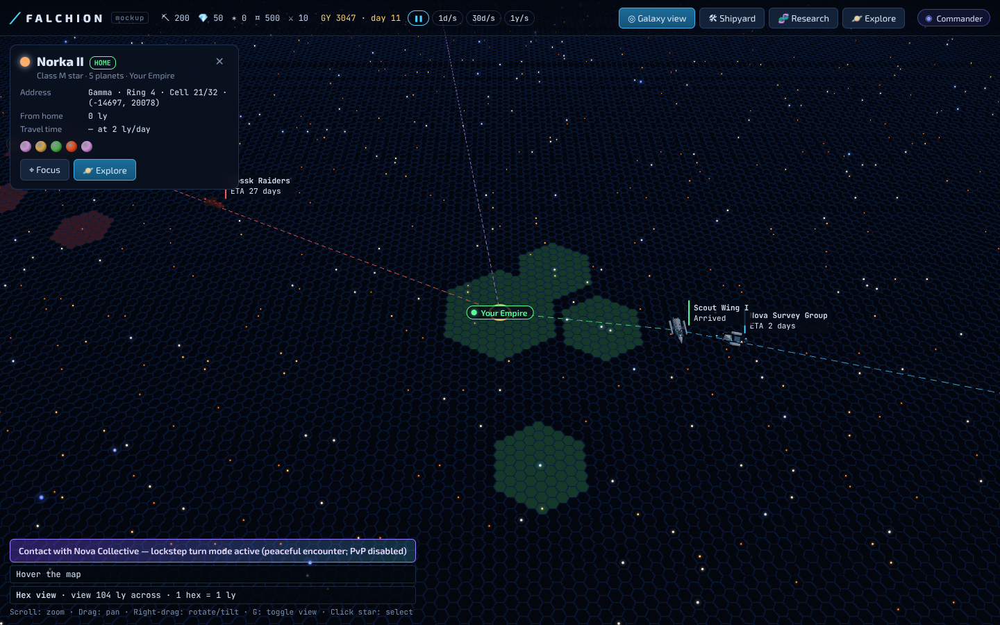
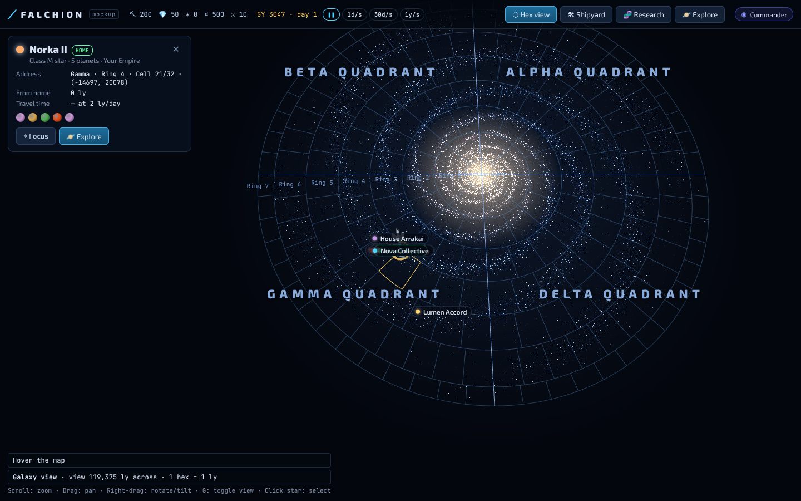
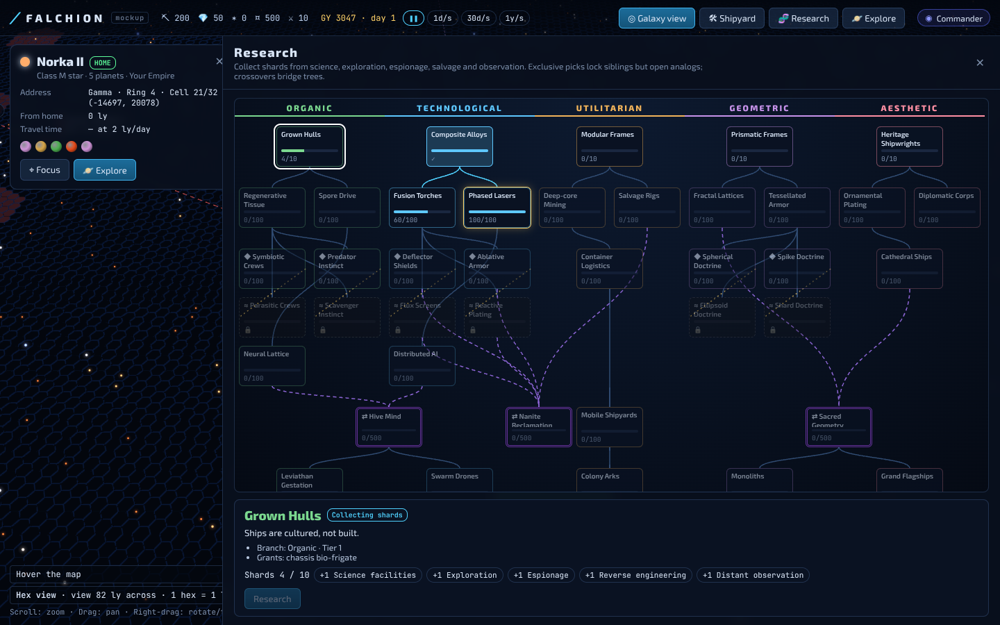
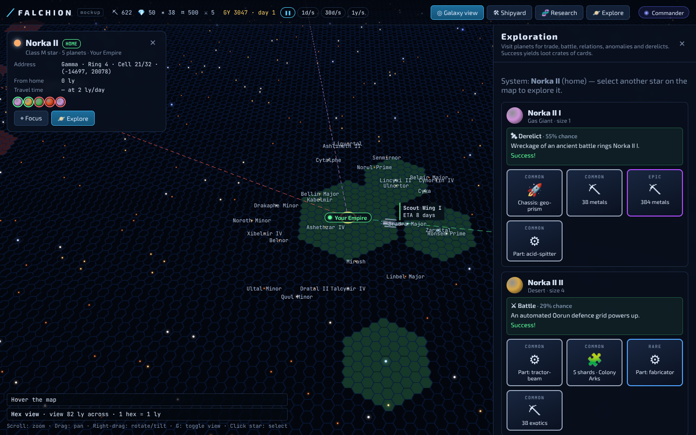
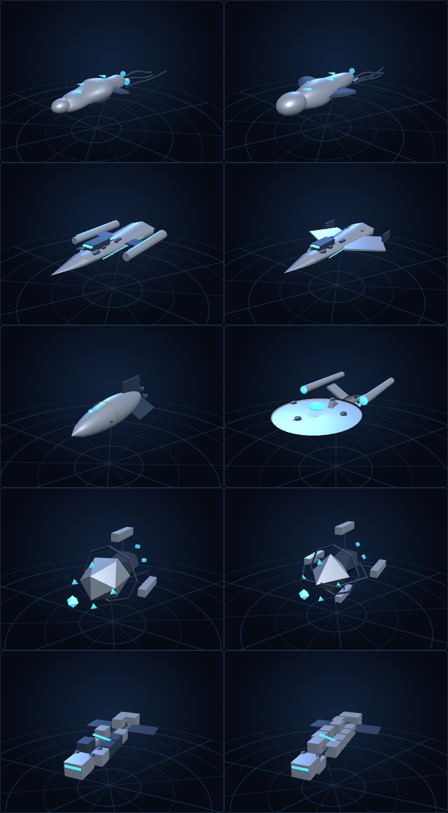
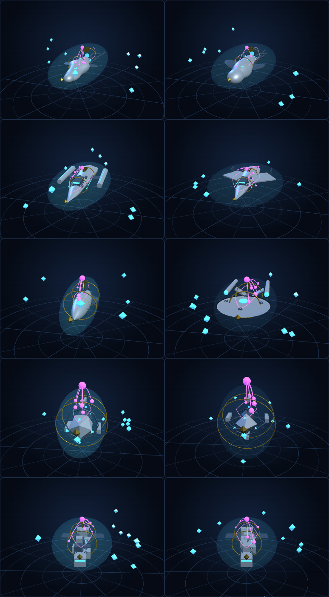

# Falchion

An at-scale, hex-based 4X MMO set in a 70,000 light-year galaxy, built with three.js and planned Discord integration.

## Quick start

```bash
npm install
npm run dev      # open the mockup
npm test         # core unit tests
```

## Mockup controls

- **Scroll**: exponential zoom from a single hex (1 ly) to the whole galaxy
- **Drag**: pan; **right-drag**: tilt/rotate
- **G**: toggle between hex view and galaxy (quadrant / radial cell) view
- **Click a star**: select it to see its sector address, distance and travel time
- Panels: **Shipyard** (procgen ship designer), **Research** (branching tech tree with shards), **Explore** (encounters and loot crates)

## Deployment

Every push to any branch builds, tests and deploys (latest push wins):

- **GitHub Pages**: the static client. One-time: Settings → Pages → Source: *GitHub Actions*; Settings → Environments → `github-pages` → allow all branches.
- **Fly.io**: `server/` (Node, serves the client + `/healthz`, `/api/info`). One-time: `fly apps create falchion`, then `fly tokens create deploy -a falchion` → repo secret `FLY_API_TOKEN`. Until then the job skips with a notice.
- Optional Discord secrets (`DISCORD_BOT_TOKEN`, `DISCORD_CLIENT_ID`, `DISCORD_CLIENT_SECRET`, `DISCORD_GUILD_ID`, `DISCORD_WEBHOOK_URL`) set as Actions secrets are staged to Fly on each deploy.

## Spec-driven development

This repo uses [OpenSpec](https://openspec.dev/). Specs and change proposals live in `openspec/`; Claude Code commands are under `/opsx:*`. Project engineering skills (SOLID, modular systems, determinism, testing) live in `.claude/skills/`.

## Screenshots

| Hex view (1 hex = 1 ly) | Galaxy view (quadrants + radial cells) |
|---|---|
|  |  |
| **Research tree** | **Exploration loot** |
|  |  |

Procedural ship styles (organic, technological, classic, geometric, utilitarian) — base and with research traits:

 

## Layout

```
src/core      pure deterministic rules (hex, galaxy, fleet, research, encounters, ship designs)
src/content   data tables (tech tree, biomes, shard sources, encounters/loot)
src/render    three.js: map layers (LOD), ship generators + traits
src/ui        DOM panels (top bar, star card, shipyard, research, explore)
src/app       composition root, store, controller, mock world/identity
openspec/     specs and change proposals
```
